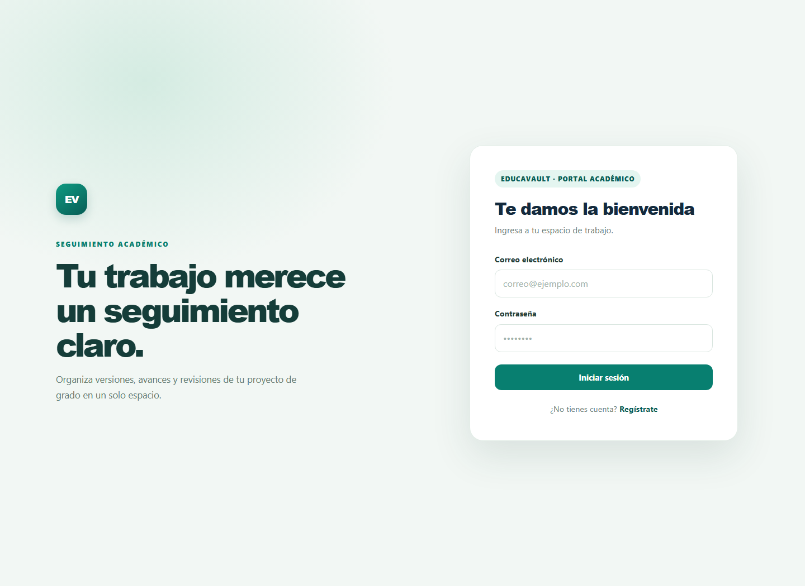
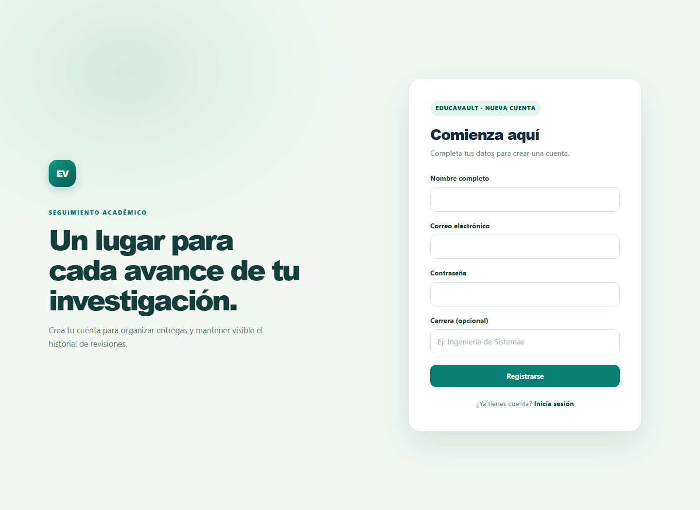
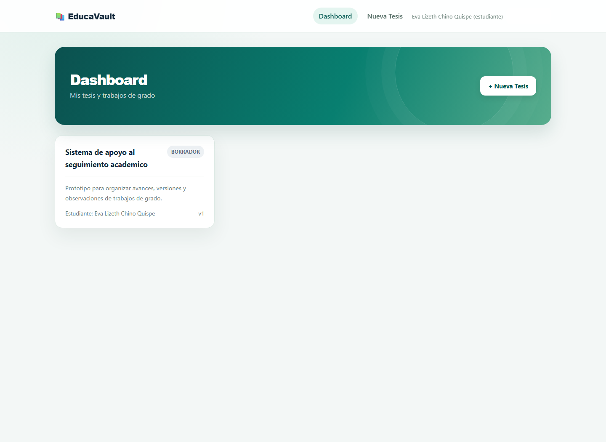
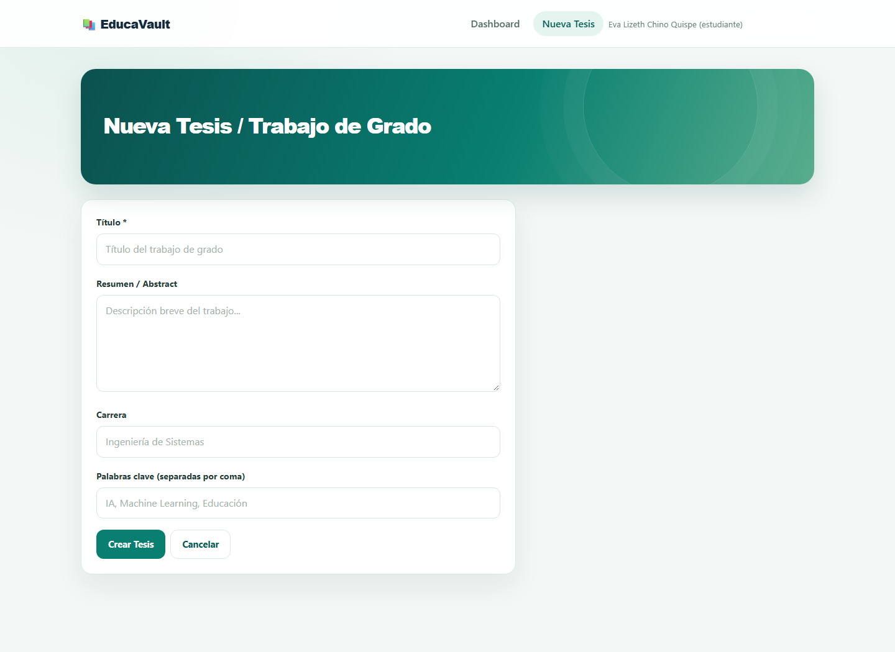
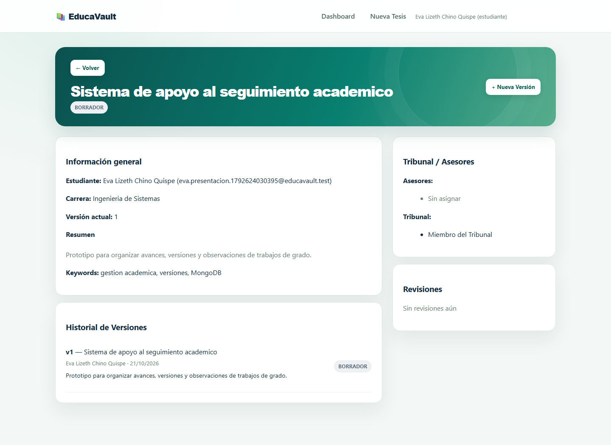
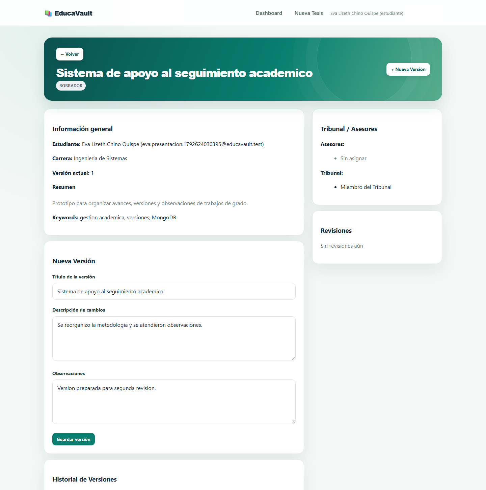
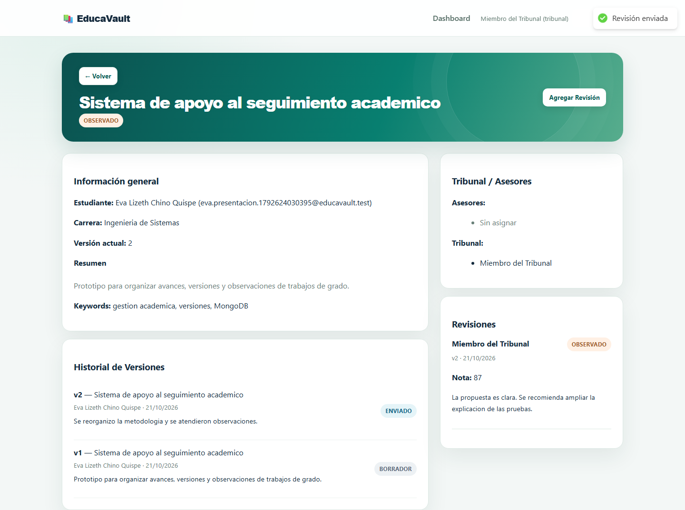
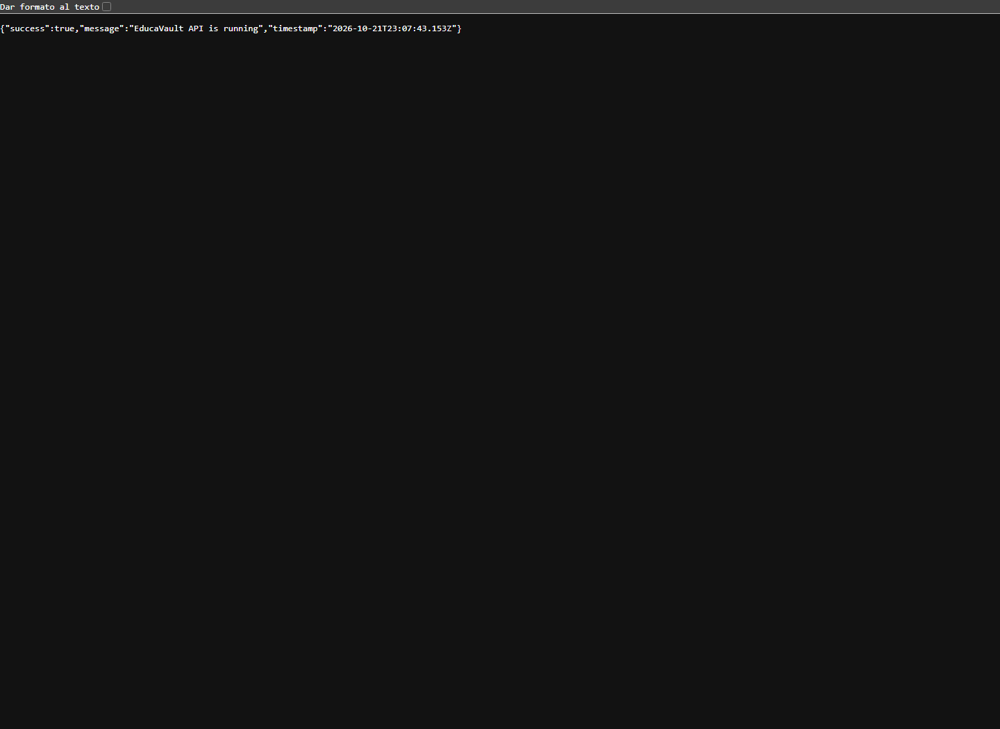

# Informe de presentación — Caso 1: EducaVault

**Universidad Adventista de Bolivia · Ingeniería de Sistemas**

**Asignatura:** Tecnologías en Internet · **Semestre:** 6.º

**Docente:** Víctor Hugo Sarzuri Flores

**Estudiante:** Eva Lizeth Chino Quispe

**Fecha de presentación:** 21 de octubre de 2026

> Evidencias capturadas durante la ejecución en la carpeta `evidencias/`.

## 1. Resumen del caso

EducaVault es una aplicación web para organizar el seguimiento de tesis y trabajos de grado. La propuesta reúne en un mismo espacio la información del trabajo, sus versiones y las observaciones del tribunal. Así se puede consultar el avance sin depender de archivos dispersos ni perder de vista qué versión fue revisada.

La solución se compone de una API REST desarrollada con Node.js y Express, una interfaz de página única (SPA) con React y Vite, y MongoDB como base de datos. El acceso a las funciones protegidas requiere autenticación mediante JWT.

## 2. Problema y objetivo

En un proceso académico, el documento suele pasar varias veces entre estudiante, asesor y tribunal. Cuando cada participante conserva copias distintas, es difícil saber cuál es la versión vigente, quién hizo una observación y qué decisión se tomó.

El objetivo de EducaVault es ofrecer un flujo centralizado para registrar tesis, añadir versiones, asignar responsables y conservar revisiones. En esta implementación se almacena la información y los metadatos del archivo (nombre y URL); no se implementa la carga binaria de documentos.

## 3. Funcionalidades demostrables

- Registro e inicio de sesión con contraseña almacenada como hash bcrypt.
- Panel que presenta tesis según el rol: estudiante, tribunal o administrador.
- Creación de una tesis con título, resumen, carrera y palabras clave.
- Registro de nuevas versiones con observaciones y datos del archivo.
- Asignación de asesores y miembros del tribunal por parte del administrador.
- Registro de una revisión con comentarios, puntuación y veredicto.
- Consulta del estado e historial de versiones y revisiones.
- Rutas protegidas en la interfaz y validación de autenticación y roles en la API.

## 4. Arquitectura y recorrido de una petición

La organización separa responsabilidades para facilitar la lectura y el mantenimiento:

| Capa | Ubicación | Responsabilidad |
|---|---|---|
| Interfaz React | `frontend/src/pages/` | Formularios, paneles y detalle de tesis |
| Servicio HTTP | `frontend/src/services/api.js` | Llamadas a la API e inclusión del token |
| Rutas REST | `backend/src/routes/` | Métodos HTTP, rutas y controles de acceso |
| Controladores | `backend/src/controllers/` | Reglas del flujo y respuestas JSON |
| Modelos | `backend/src/models/` | Esquemas, validaciones y relaciones Mongoose |
| Middleware | `backend/src/middleware/` | Autenticación, roles y errores |

Por ejemplo, al crear una tesis, React envía los datos a `POST /api/thesis`. La ruta comprueba el token y el rol; el controlador crea el documento y responde con HTTP 201. Para una petición inválida, la API responde con el estado y el mensaje de error correspondiente.

## 5. API REST y permisos

Todas las rutas de tesis requieren autenticación. El middleware `authorize` limita las operaciones según el rol.

| Método | Ruta | Función | Acceso previsto |
|---|---|---|---|
| POST | `/api/auth/register` | Registrar una cuenta | Público |
| POST | `/api/auth/login` | Iniciar sesión y obtener JWT | Público |
| GET | `/api/auth/me` | Consultar el perfil autenticado | Autenticado |
| GET | `/api/thesis` | Listar tesis visibles para el usuario | Autenticado |
| POST | `/api/thesis` | Crear una tesis | Estudiante o administrador |
| GET | `/api/thesis/:id` | Consultar el detalle | Propietario, tribunal asignado o administrador |
| POST | `/api/thesis/:id/versions` | Añadir una versión | Estudiante propietario o administrador |
| POST | `/api/thesis/:id/reviews` | Añadir una revisión | Tribunal asignado o administrador |
| PUT | `/api/thesis/:id/assign` | Asignar asesores y tribunal | Administrador |
| PUT | `/api/thesis/:id` | Actualizar campos de la tesis | Estudiante propietario o administrador; calificación y estado solo para administrador |
| GET | `/api/health` | Comprobar disponibilidad de la API | Público |

La API utiliza respuestas como 201 para creación, 400 para datos inválidos, 401 para falta de autenticación, 403 para permisos insuficientes y 404 para recursos inexistentes. El manejador central también traduce errores de validación de Mongoose.

## 6. Modelo NoSQL y decisiones de persistencia

La colección `users` conserva por separado los datos de identidad y rol. El documento `theses` referencia al estudiante, asesores, tribunal, autores de versiones y revisores mediante `ObjectId` y `ref: 'User'`. Al consultar una tesis, `populate` permite presentar los nombres y datos requeridos sin duplicar perfiles completos dentro de cada tesis.

Las versiones y revisiones se modelan como subdocumentos de la tesis. Su relación directa con el ciclo de vida del trabajo hace práctico consultarlas junto con este, conservar su historial y actualizarlas como parte del mismo agregado. Los esquemas incluyen campos obligatorios, estados permitidos y límites de puntuación. También se define un índice de texto para buscar por título, resumen y palabras clave.

Esta combinación evita tanto el embebido indiscriminado de usuarios como la fragmentación de eventos que normalmente se leen junto con la tesis.

## 7. Autenticación y configuración segura

1. El usuario inicia sesión o se registra; el servidor compara la contraseña y firma un JWT con el identificador del usuario. El JWT está firmado, no cifrado.
2. El token contiene el identificador, no la contraseña. El vencimiento se configura con `JWT_EXPIRES_IN`.
3. El frontend conserva el token en `localStorage` y Axios lo envía como `Authorization: Bearer <token>`.
4. `protect` verifica la firma y carga al usuario sin su contraseña; `authorize` comprueba el rol cuando la ruta lo exige.
5. Las contraseñas se procesan con bcrypt y 12 rondas de sal. El campo `password` no se selecciona por defecto en consultas Mongoose.

El registro público crea cuentas de estudiante; enviar un campo `role` en la solicitud no concede privilegios. Las cuentas de tribunal y administración deben prepararse por un proceso interno. Un miembro del tribunal solo consulta y revisa tesis que le fueron asignadas. En la actualización, el estudiante solo puede cambiar su propia tesis y no puede asignar estados ni nota final; esas dos acciones quedan para administración.

`MONGODB_URI` y `JWT_SECRET` se configuran en `backend/.env`, que no debe publicarse. El repositorio contiene una plantilla `.env.example` con valores de ejemplo; para una base alojada, se reemplazan localmente por la URI y el secreto correspondientes. Nunca se debe mostrar un secreto ni un JWT en las capturas.

## 8. Instalación y ejecución en Windows

Se requiere Node.js 18 o superior, npm y una instancia accesible de MongoDB local o Atlas. El proyecto incluye archivos `package-lock.json`; por eso `npm install` puede reconstruir las dependencias. No es necesario entregar ni copiar `node_modules`.

**Terminal 1 — API**

```powershell
cd Caso1\codigo\backend
Copy-Item .env.example .env
notepad .env
npm install
npm run dev
```

En `.env`, configurar `MONGODB_URI`, un `JWT_SECRET` propio y `PORT=5000`. Si ya existe un `.env`, no lo sobrescribas: revisa que tenga esos valores. La API queda en `http://localhost:5000`; su comprobación de estado está en `http://localhost:5000/api/health`.

**Terminal 2 — interfaz**

```powershell
cd Caso1\codigo\frontend
npm install
npm run dev
```

Abrir `http://localhost:3000`. Vite redirige las solicitudes `/api` hacia la API del puerto 5000.

## 9. Guion de demostración y evidencias

Usar cuentas y datos de prueba, nunca credenciales reales. Para demostrar los distintos roles, preparar cuentas de estudiante, tribunal y administrador. Cada evidencia muestra una etapa concreta del recorrido; las capturas no incluyen contraseñas ni tokens.

| Archivo sugerido | Qué debe mostrar |
|---|---|
| `evidencias/01-login.png` | Acceso al portal académico |
| `evidencias/02-registro.png` | Formulario de registro con roles de demostración |
| `evidencias/03-panel-estudiante.png` | Panel del estudiante y tesis registradas |
| `evidencias/04-nueva-tesis.png` | Formulario de creación de un trabajo |
| `evidencias/05-detalle-tesis.png` | Resumen, estado y datos de una tesis |
| `evidencias/06-nueva-version.png` | Versión agregada y campos de observación |
| `evidencias/07-revision-tribunal.png` | Revisión, comentarios y decisión del tribunal |
| `evidencias/08-api-health.png` | Respuesta de `/api/health` en la API en ejecución |

**Recorrido recomendado:** iniciar sesión como estudiante, crear una tesis, registrar una versión, consultar el detalle, entrar con una cuenta de tribunal y guardar una revisión. Finalmente, mostrar que la API protege las operaciones que requieren otro rol. No afirmar que se probó un paso si no se ejecutó.

### Capturas de ejecución

















## 10. Correspondencia con la rúbrica

| Criterio | Evidencia que se explica o debe demostrarse |
|---|---|
| Arquitectura backend y API REST | Separación entre rutas, controladores, modelos y middleware; métodos y códigos HTTP |
| Persistencia NoSQL y Mongoose | Referencias con `ObjectId`/`populate`, subdocumentos, validaciones e índice de texto |
| Seguridad JWT y variables de entorno | Firma y verificación del token, roles, bcrypt y configuración fuera del código |
| Frontend React SPA | Formularios, rutas protegidas, hooks `useState`/`useEffect` y consumo de la API con Axios |
| Despliegue, repositorio y documentación | Pasos de instalación reproducibles, `.env.example`, `package-lock.json` y ausencia de dependencias vendorizadas |
| Defensa y autoría | Explicar el recorrido de una petición, por qué se combinan referencias y subdocumentos y qué contiene el JWT |

## 11. Cierre

EducaVault propone un flujo digital sencillo para dar seguimiento a trabajos de grado y conservar su historial. La separación por capas, el modelado mixto de MongoDB y la autenticación por roles responden a las necesidades principales del sistema. En la exposición, cada decisión se puede relacionar con una pantalla y con la parte del código que la implementa.
