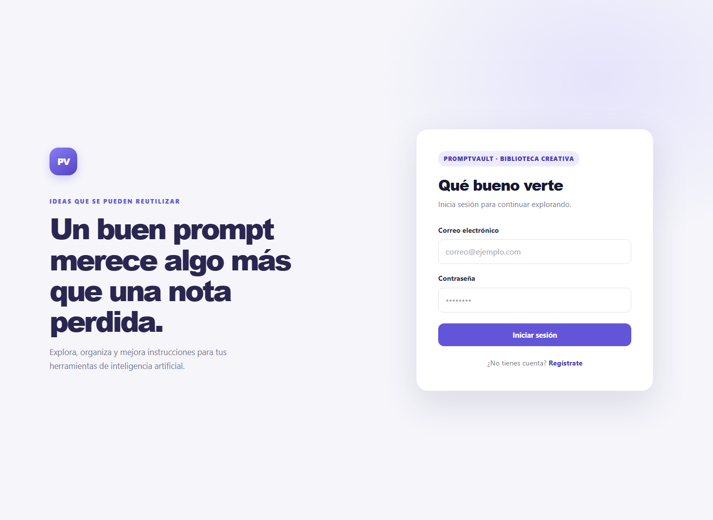
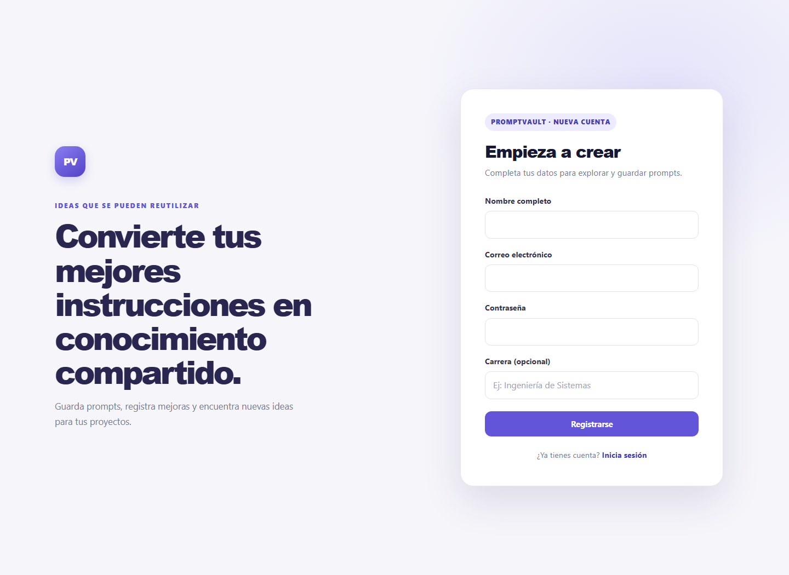
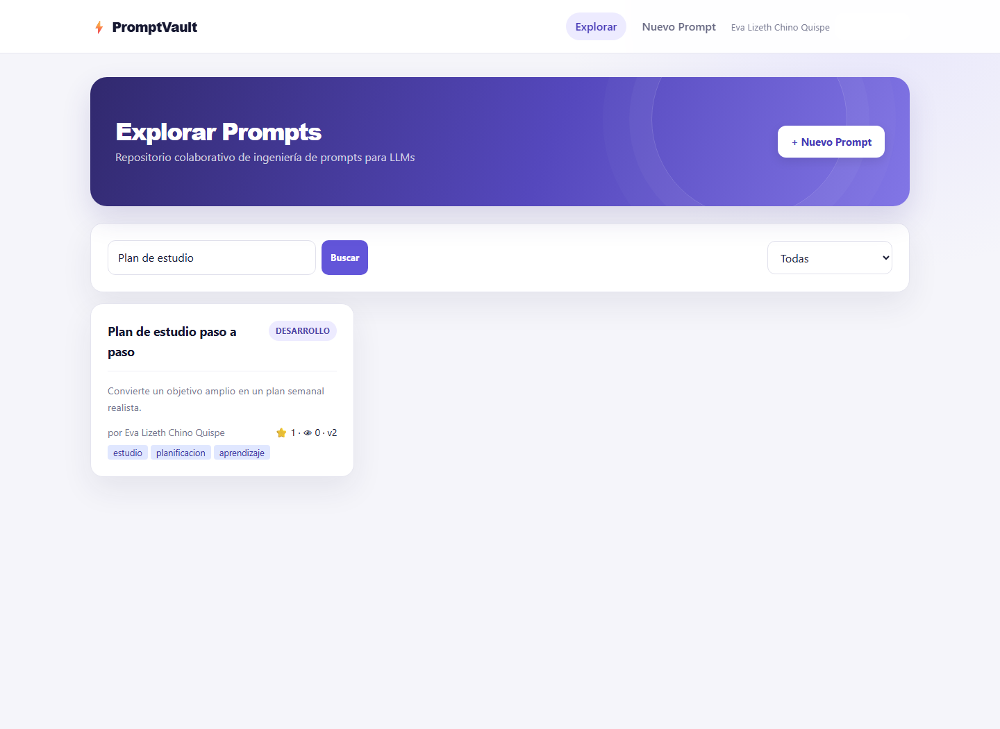
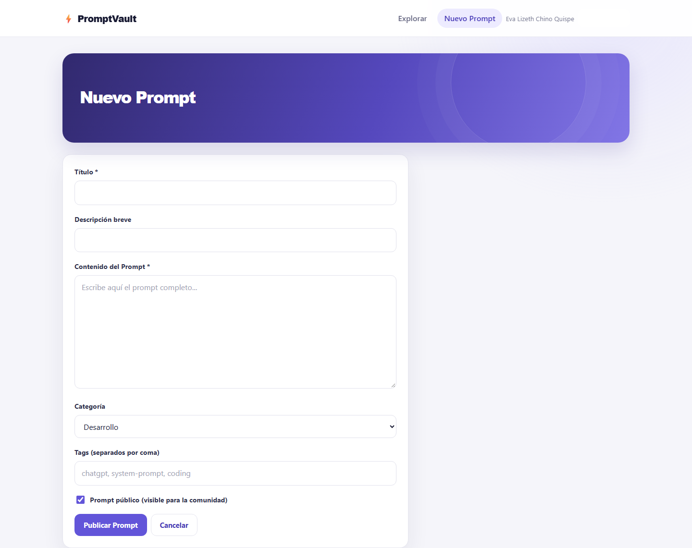
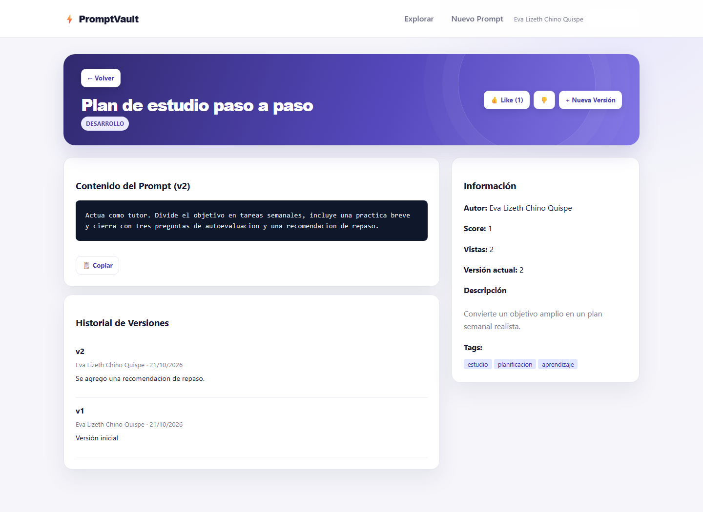
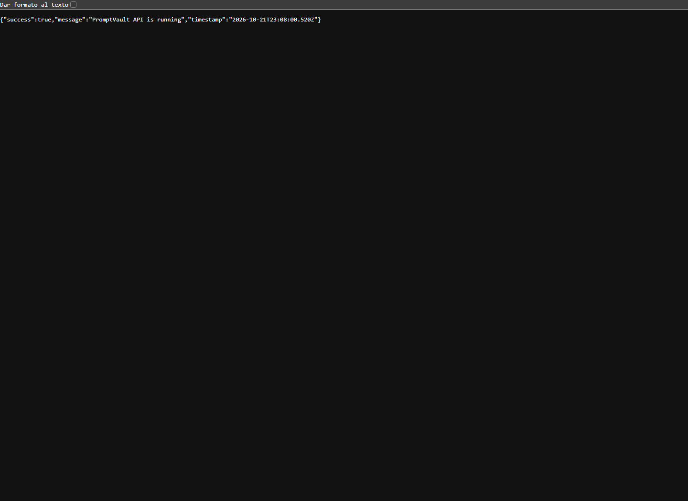

# Informe de presentación — Caso 2: PromptVault

**Universidad Adventista de Bolivia · Ingeniería de Sistemas**

**Asignatura:** Tecnologías en Internet · **Semestre:** 6.º

**Docente:** Víctor Hugo Sarzuri Flores

**Estudiante:** Eva Lizeth Chino Quispe

**Fecha de presentación:** 21 de octubre de 2026

> Evidencias capturadas durante la ejecución en la carpeta `evidencias/`.

## 1. Resumen del caso

PromptVault es un repositorio colaborativo para guardar y reutilizar prompts destinados a modelos de lenguaje. Cada aporte puede organizarse por categoría y etiquetas, actualizarse mediante versiones y valorarse con votos. El autor también puede decidir si su prompt es público o privado.

La solución utiliza una API REST con Node.js y Express, una interfaz React/Vite y MongoDB con Mongoose. Las operaciones del repositorio requieren una sesión autenticada.

## 2. Problema y objetivo

Los prompts útiles suelen quedar dispersos entre notas personales, documentos y conversaciones. Esa dispersión dificulta encontrar buenas instrucciones, conocer su propósito y conservar los cambios que mejoran sus resultados.

PromptVault busca centralizar ese conocimiento y facilitar su consulta por texto, categoría o etiqueta. La interfaz ofrece búsqueda de texto y filtro por categoría; la API también admite filtro por etiqueta. El historial de versiones permite revisar la evolución del contenido, mientras que los votos y el número de vistas ofrecen señales básicas de uso y valoración.

## 3. Funcionalidades demostrables

- Registro e inicio de sesión; rutas de la aplicación protegidas.
- Creación y edición de prompts con título, contenido, descripción, categoría, etiquetas y visibilidad.
- Búsqueda de prompts y filtro por categoría.
- Consulta de detalles, autoría, etiquetas, puntuación, vistas y versiones.
- Creación de versiones con una nota de cambios, restringida al autor o al administrador.
- Voto positivo o negativo, con un voto vigente por usuario y prompt.
- Copia del contenido al portapapeles desde la vista de detalle.
- Acceso a prompts privados limitado al autor o al administrador.

## 4. Arquitectura y recorrido de una petición

La separación del proyecto permite explicar cada responsabilidad de forma concreta:

| Capa | Ubicación | Responsabilidad |
|---|---|---|
| Interfaz React | `frontend/src/pages/` | Exploración, búsqueda, formularios y detalle |
| Servicio HTTP | `frontend/src/services/api.js` | Configuración de Axios y envío del token |
| Rutas REST | `backend/src/routes/` | Métodos HTTP y middleware de autenticación |
| Controladores | `backend/src/controllers/` | Validaciones y reglas del repositorio |
| Modelos | `backend/src/models/` | Esquemas, referencias y subdocumentos |
| Middleware | `backend/src/middleware/` | JWT, autorización y respuestas de error |

Por ejemplo, al crear un prompt, el frontend realiza `POST /api/prompts`. La ruta comprueba la sesión; el controlador valida título y contenido y guarda el prompt junto con su primera versión. El servidor devuelve HTTP 201 y la interfaz actualiza la vista.

## 5. API REST y reglas de acceso

Las rutas de prompts se encuentran detrás del middleware `protect`: incluso las consultas del catálogo requieren autenticación. Además, las operaciones de edición, eliminación y nueva versión verifican que quien las solicita sea el autor o un administrador.

| Método | Ruta | Función | Regla de acceso |
|---|---|---|---|
| POST | `/api/auth/register` | Registrar una cuenta | Público |
| POST | `/api/auth/login` | Iniciar sesión y obtener JWT | Público |
| GET | `/api/auth/me` | Consultar el perfil autenticado | Autenticado |
| GET | `/api/prompts` | Listar prompts públicos y propios privados | Autenticado; máximo 50 resultados |
| POST | `/api/prompts` | Crear un prompt | Autenticado |
| GET | `/api/prompts/:id` | Consultar un prompt y aumentar sus vistas | Autenticado; privado solo para autor/admin |
| POST | `/api/prompts/:id/versions` | Agregar una versión | Autor o administrador |
| POST | `/api/prompts/:id/vote` | Registrar o reemplazar un voto | Autenticado |
| PUT | `/api/prompts/:id` | Editar metadatos y visibilidad | Autor o administrador |
| DELETE | `/api/prompts/:id` | Eliminar un prompt | Autor o administrador |
| GET | `/api/health` | Comprobar disponibilidad de la API | Público |

Se validan los campos obligatorios y que el voto sea `1` o `-1`. Entre las respuestas contempladas están 201 para creación, 400 para entrada inválida, 401 para una sesión no válida, 403 para una operación no permitida y 404 cuando el prompt no existe.

## 6. Modelo NoSQL y decisiones de persistencia

Cada prompt conserva su autor como referencia `ObjectId` a `User`. También se guardan referencias a los usuarios que crean versiones o emiten votos. `populate` incorpora los datos de autoría necesarios al consultar, evitando copiar perfiles enteros dentro de cada prompt.

Las versiones y los votos son subdocumentos del prompt. En este caso es útil consultarlos en el contexto del contenido al que pertenecen; además, permite guardar la evolución y recalcular la puntuación a partir de los votos. El esquema restringe las categorías disponibles, valida los campos requeridos y normaliza las etiquetas a minúsculas. Un índice de texto considera título, descripción, contenido y etiquetas para la búsqueda.

La decisión combina referencias para los usuarios compartidos por muchos prompts y subdocumentos para los datos que forman parte del ciclo de vida de un prompt.

## 7. Autenticación y configuración segura

1. Registro o inicio de sesión: el servidor compara la contraseña con el hash almacenado y firma un JWT con el identificador del usuario. El JWT está firmado, no cifrado.
2. El payload guarda el identificador, no la contraseña. La vigencia se controla con `JWT_EXPIRES_IN`.
3. El cliente conserva el token en `localStorage`; Axios envía el encabezado `Authorization: Bearer <token>`.
4. `protect` verifica el token y recupera el usuario sin seleccionar el campo de contraseña.
5. Las contraseñas se procesan con bcrypt y 12 rondas de sal; las operaciones de escritura comprueban el propietario y, cuando corresponde, el rol administrador.

Configurar `MONGODB_URI` y `JWT_SECRET` en `backend/.env`. Este archivo contiene valores privados y no debe publicarse. El repositorio incluye una plantilla `.env.example`; al usar una base alojada, sus valores de ejemplo se reemplazan localmente. Nunca incluir secretos ni JWT en las capturas.

El registro público crea cuentas de estudiante; el servidor ignora cualquier rol que el cliente intente incluir. Las cuentas con permisos administrativos deben prepararse por un proceso interno, no mediante el formulario público.

## 8. Instalación y ejecución en Windows

Se necesita Node.js 18 o superior, npm y acceso a una instancia de MongoDB local o Atlas. Los `package-lock.json` permiten instalar las versiones resueltas. Las carpetas `node_modules` no forman parte de la entrega y no es necesario enviarlas.

**Terminal 1 — API**

```powershell
cd Caso2\codigo\backend
Copy-Item .env.example .env
notepad .env
npm install
npm run dev
```

En `.env`, configurar la URI de MongoDB, un secreto JWT propio, `NODE_ENV=development` y `PORT=5001`. Si ya existe un `.env`, no lo sobrescribas; confirma que el puerto sea 5001. La API responde en `http://localhost:5001`; el estado se puede comprobar en `http://localhost:5001/api/health`.

**Terminal 2 — interfaz**

```powershell
cd Caso2\codigo\frontend
npm install
npm run dev
```

Abrir `http://localhost:3001`. Vite reenvía las solicitudes `/api` a la API que escucha en el puerto 5001.

## 9. Guion de demostración y evidencias

Preparar una cuenta y datos de prueba antes de exponer. No mostrar contraseñas, archivos `.env` ni tokens. Cada captura corresponde a una etapa concreta del recorrido.

| Archivo sugerido | Qué debe mostrar |
|---|---|
| `evidencias/01-login.png` | Pantalla de inicio de sesión y dirección local |
| `evidencias/02-registro.png` | Formulario de registro de una cuenta |
| `evidencias/03-explorar.png` | Catálogo de prompts disponibles |
| `evidencias/04-busqueda-filtros.png` | Resultado de una búsqueda o categoría elegida |
| `evidencias/05-nuevo-prompt.png` | Formulario con los datos de un prompt |
| `evidencias/06-detalle-versiones.png` | Contenido, autoría e historial de versiones |
| `evidencias/07-votacion-y-copia.png` | Voto negativo registrado, puntuación actualizada y opción de copia |
| `evidencias/08-api-health.png` | Respuesta de `/api/health` en la API en ejecución |

**Recorrido recomendado:** iniciar sesión, buscar un prompt por palabra o categoría, abrirlo, copiar el contenido, emitir un voto y añadir una versión como autor. Para mostrar privacidad, crear un prompt privado y comprobar el acceso desde otra cuenta. No presentar como evidencia una operación que no se haya ejecutado.

### Capturas de ejecución















## 10. Correspondencia con la rúbrica

| Criterio | Evidencia que se explica o debe demostrarse |
|---|---|
| Arquitectura backend y API REST | Rutas, controladores, middleware, códigos HTTP y flujo de una operación |
| Persistencia NoSQL y Mongoose | Referencias `ObjectId`/`populate`, versiones y votos embebidos, validaciones e índice |
| Seguridad JWT y variables de entorno | Hash de contraseñas, token firmado, middleware de protección y secreto externo |
| Frontend React SPA | Hooks `useState`/`useEffect`, navegación protegida, búsqueda, filtros y cliente Axios |
| Despliegue, repositorio y documentación | Instalación reproducible, configuración MongoDB, lockfiles y exclusión de dependencias instaladas |
| Defensa y autoría | Justificar referencias y subdocumentos, explicar el cálculo del score y describir el payload JWT |

## 11. Cierre

PromptVault convierte una colección dispersa de instrucciones en un repositorio consultable y con historial. La propuesta combina una API organizada, persistencia NoSQL adecuada al ciclo de vida del prompt y una interfaz enfocada en explorar y reutilizar contenido. La exposición se completa mostrando el flujo real, las restricciones de acceso y las evidencias capturadas durante la ejecución.
